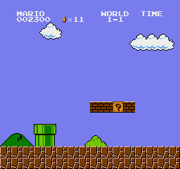

# NeSLE

**Thousands of NES consoles on one GPU, for reinforcement learning.**

NeSLE runs the whole NES (6502 CPU, PPU, bus) inside a CUDA kernel, one thread
per console. Observations never leave the GPU, so your RL loop stops waiting on
the emulator.

[](https://github.com/hbofz/NeSLE/actions/workflows/ci.yml)
[](LICENSE)
[](https://www.python.org/downloads/)



*A PPO agent clearing World 1-1 after 2.5 hours of training on a GTX 1050 Ti.*

## Why

| Setup | Env-steps/s |
|---|---:|
| `nes-py` on all 12 CPU threads | 767 |
| NeSLE, GTX 1050 Ti, 4,096 envs | 177,401 |
| NeSLE, A100, 65,536 envs | **3,267,050** |

That's about 13 million NES frames per second on one A100. These numbers are
best case (every env pressing the same button). With random per-env actions
the 1050 Ti is about 6x slower, still 37x the CPU stack.
[Full benchmarks and method](docs/benchmark-gpu-vs-cpu.md).

## Features

- **GPU-resident PPO** that keeps rollouts and training on device.
- **Stable-Baselines3 compatible** `VecEnv`, drops into existing code.
- **Instant resets** from bundled save states for all 8 worlds.
- **On-GPU reward shaping** and Mario RAM parsing.

## Quickstart

Needs a CUDA GPU, CUDA Toolkit 12.x, Python 3.10+, and a C++20 compiler.

```sh
git clone https://github.com/hbofz/NeSLE.git && cd NeSLE
python -m pip install -e '.[dev,rl]'
python -m pip install --force-reinstall torch --index-url https://download.pytorch.org/whl/cu126
```

Bring your own legally obtained `Super Mario Bros. (World).nes`. No ROMs are
included. Windows and Docker: [docs/install.md](docs/install.md).

```python
import nesle

envs = nesle.make_vec(
    "Super Mario Bros. (World).nes",
    num_envs=2048,
    backend="cuda",
    observation_mode="ram",
    action_space="mario",
    reset_state_path="docs/data/smb_level1_1.state",
)
obs = envs.reset()
obs, rewards, dones, infos = envs.step([envs.action_space.sample() for _ in range(envs.num_envs)])
```

Train an agent:

```sh
python examples/native_ppo_train.py "Super Mario Bros. (World).nes" \
    --reset-state-path docs/data/smb_level1_1.state \
    --action-space mario --reward-mode smart \
    --num-envs 2048 --total-timesteps 25_000_000
```

All flags: [docs/training.md](docs/training.md).

## Limitations

- Mappers 0, 2, 34 and 94 only (no MMC1/MMC3 yet). The RL tooling targets Super Mario Bros.
- Windows caps training near 3k env-steps/s. Linux is unaffected.
- [Everything else](KNOWN_ISSUES.md).

## Contributing

PRs welcome. Start with a
[good first issue](https://github.com/hbofz/NeSLE/issues?q=is%3Aopen+label%3A%22good+first+issue%22),
or take on the big one:
[MMC1/MMC3 mappers](https://github.com/hbofz/NeSLE/issues/5), which would unlock
hundreds of games. See [CONTRIBUTING.md](CONTRIBUTING.md).

More docs: [architecture](docs/architecture.md) ·
[design](docs/design.md) · [GPU scaling](docs/gpu-scaling.md)

MIT licensed. Not affiliated with Nintendo.
